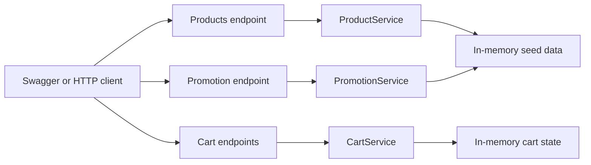
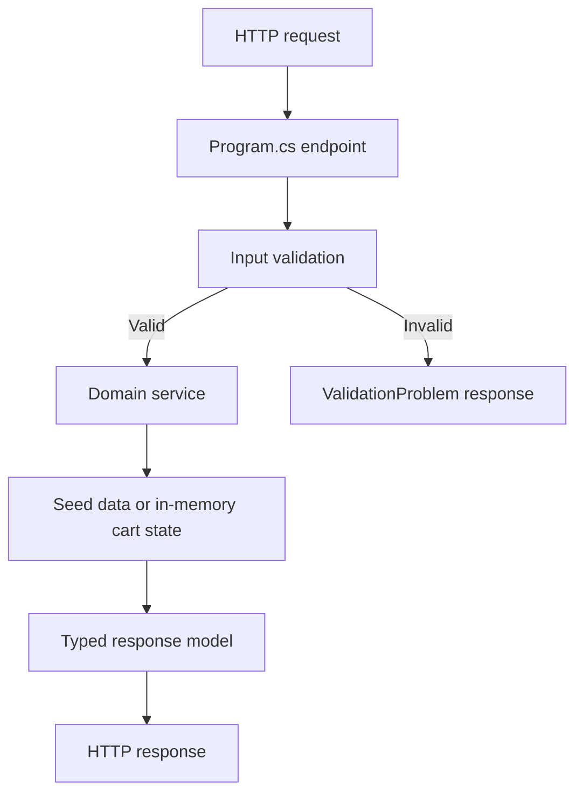

# GHCP Contoso Clothing

GitHub Copilot workshop reference implementation for a small .NET 8 storefront
API modernization lab.

[License: MIT](LICENSE) [.NET 8](https://dotnet.microsoft.com/) [ASP.NET Core](https://learn.microsoft.com/aspnet/core/) [GitHub Copilot](https://github.com/features/copilot)

## Overview

This repository contains a confidentiality-safe, fictional storefront API lab for
early-career engineers and workshop participants. The app shows how a small
retail API can expose product browsing, cart management, promotion validation,
health checks, version metadata, Swagger documentation, automated tests, and a
simple GitHub Actions workflow.

The implementation is intentionally small rather than production-deep. It gives
participants a realistic but approachable codebase for practicing GitHub
Copilot, GitHub Flow, debugging, refactoring, unit testing, documentation,
secure coding basics, and pull request review habits.

## Prerequisites

### Must-Have Now

| Tool | Why you need it |
| --- | --- |
| GitHub account | Required to fork, clone, open Codespaces, and use Copilot-assisted workshop flows. |
| Git | Required to clone the repository, create branches, and practice GitHub Flow. |
| VS Code | Recommended editor for the workshop exercises, reusable prompt files, and Copilot Chat. |
| .NET 8 SDK | Required to restore, build, test, and run the API locally. |
| GitHub Copilot | Recommended for the workshop exercises; the API itself can build and run without Copilot. |

### Additional Tools By Path

| Path | Additional tools |
| --- | --- |
| GitHub Codespaces | No local build tools required beyond a browser or VS Code. The default Codespaces image includes Git and the .NET SDK. |
| Local Windows, macOS, or Linux setup | .NET 8 SDK, Git, and VS Code. |
| API exploration | Browser access to Swagger, or an HTTP client such as the VS Code REST Client extension, curl, or Postman. |
| GitHub Flow practice | GitHub CLI is optional, but useful for creating issues, branches, and pull requests from the terminal. |
| Copilot workshop flows | A Copilot-enabled GitHub account and access to Copilot Chat in VS Code. |

### Local Setup Preflight

When running locally, first open the repository in VS Code and confirm the .NET
SDK is available:

```bash
dotnet --info
```

Then restore, build, and test the solution before starting an exercise:

```bash
dotnet restore GhcpContosoClothing.sln
dotnet build GhcpContosoClothing.sln --no-restore
dotnet test GhcpContosoClothing.sln --no-build
```

### Permissions And Licensing

| Activity | Requirement |
| --- | --- |
| Run validation commands | Read access to this repository and permission to run local developer tools. |
| Use Codespaces | Codespaces enabled for your GitHub account or organization. |
| Fork for workshop edits | Permission to fork public repositories, or permission to create a copy inside your organization. |
| Push changes or open PRs | Write access to your fork or target repository. |
| Use GitHub Copilot | Copilot Individual, Business, Enterprise, or another license assigned by your organization. |

If your organization restricts Codespaces, Copilot, GitHub Actions, or
third-party extensions through policy, confirm those features with your
administrator before the workshop. This repository is licensed under [MIT](LICENSE).

## Choose Your Path

| Path | Typical time | Best for | Status |
| --- | --- | --- | --- |
| GitHub Codespaces | 5-10 min | Participants who want the least local setup | Recommended |
| Local VS Code setup | 10-15 min | Participants who already have .NET installed | Supported |
| Manual Windows validation | 10-15 min | Windows users validating from PowerShell | Supported |
| Facilitator walkthrough | 15-20 min | Instructors leading a group through setup and first API run | Supported |

### Option A - GitHub Codespaces

1. Open the repository in GitHub.
2. Select Code > Codespaces > Create codespace on main.
3. Wait for the environment to finish loading. The first setup can take a few
   minutes.
4. Open a terminal and continue with Validate The Stack.

Codespaces is the recommended workshop path when local .NET installation is a
barrier. If the selected image does not include .NET 8, install the SDK or use a
local VS Code setup.

### Option B - Local VS Code Setup

1. Install [VS Code](https://code.visualstudio.com/), Git, and the [.NET 8 SDK](https://dotnet.microsoft.com/download/dotnet/8.0).
2. Clone or fork the repository using Fork And Clone.
3. Open the repository folder in VS Code.
4. Run `dotnet --info` in the integrated terminal.
5. Continue with Validate The Stack.

### Option C - Manual Windows Validation

Use this path when you want to run the API, tests, and Swagger locally from
PowerShell.

1. Install Git for Windows and the [.NET 8 SDK](https://dotnet.microsoft.com/download/dotnet/8.0).
2. Open a new PowerShell terminal so PATH changes are loaded.
3. Verify the SDK:

   ```powershell
   dotnet --info
   ```

4. Clone or fork the repository using Fork And Clone.
5. Open the repository in VS Code.
6. Run the commands in Validate The Stack.

### Option D - Facilitator Walkthrough

Use this path when you are leading the workshop and want all participants to
start from the same checkpoints.

1. Confirm every participant can open the repository in Codespaces or local VS
   Code.
2. Ask participants to run `dotnet test GhcpContosoClothing.sln` before making
   changes.
3. Open Swagger and walk through the API endpoints.
4. Start with the setup exercise, then move into a small scoped issue or prompt
   file exercise.

## Fork And Clone

Forking is recommended when you plan to edit the repository, open pull requests,
or use it as a workshop sandbox.

1. On GitHub, select Fork.
2. Clone your fork:

   ```bash
   git clone https://github.com/YOUR-USERNAME/ghcp-contoso-clothing.git
   cd ghcp-contoso-clothing
   ```

3. Verify the solution builds:

   ```bash
   dotnet build GhcpContosoClothing.sln
   ```

If your organization uses GitHub Enterprise Managed Users and cannot fork
external repositories, create an empty repository in your allowed namespace, clone
this source repository, then change `origin` to your new repository:

```bash
git clone https://github.com/multi-layer-perceptron/ghcp-contoso-clothing.git
cd ghcp-contoso-clothing
git remote set-url origin https://github.com/YOUR-ORG-OR-USER/ghcp-contoso-clothing.git
git push --all origin
git push --tags origin
```

## Getting Started Tutorial

### Validate The Stack

Run these commands from the repository root. Codespaces and properly configured
local environments should both support the same solution commands.

### .NET API Workflow

```bash
dotnet restore GhcpContosoClothing.sln
dotnet build GhcpContosoClothing.sln --no-restore
dotnet test GhcpContosoClothing.sln --no-build
```

Expected result: the solution restores, builds, and the xUnit tests pass across
product listing, product lookup, cart validation, cart item creation, promotion
validation, and health checks.

### Run The API

```bash
dotnet run --project src/ContosoClothing.Api
```

Expected result: the API starts on the configured launch profile. The HTTP
profile uses `http://localhost:5122`; the HTTPS profile uses
`https://localhost:7061` and `http://localhost:5122`.

### Open Swagger

Start the API, then open one of these URLs:

* [http://localhost:5122/swagger](http://localhost:5122/swagger)
* [https://localhost:7061/swagger](https://localhost:7061/swagger)

Expected result: Swagger lists the product, cart, promotion, health, and version
endpoints.

### API Endpoint Tour

Use Swagger, curl, or the REST Client extension to try the main endpoints:

```http
GET http://localhost:5122/api/products
GET http://localhost:5122/api/products/1
GET http://localhost:5122/api/cart/demo-cart
POST http://localhost:5122/api/cart/demo-cart/items
POST http://localhost:5122/api/promotions/validate
GET http://localhost:5122/health
GET http://localhost:5122/api/version
```

For POST requests, use JSON bodies like these:

```json
{
  "productId": 1,
  "quantity": 2
}
```

```json
{
  "code": "SAVE10",
  "subtotal": 75
}
```

## Storefront API Tutorial

The minimal API is the workshop's main hands-on surface. It walks participants
through the same path the tests exercise: browse products, add an item to a cart,
validate a promotion, inspect health, and use generated API documentation.

### API Workflow Diagram



### Step 1 - Browse Products

Purpose: retrieve the fictional product catalog and inspect a single product by
ID.

How to use it:

1. Start the API.
2. Call `GET /api/products` to list products such as Trail Jacket, Canvas Tote,
   and Travel Backpack.
3. Call `GET /api/products/{id}` with a known ID to inspect one product.
4. Call the same endpoint with an unknown ID to see the safe not-found response.

What this step produces: a list of `Product` records or a single `Product` with
ID, name, category, price, and quantity available.

### Step 2 - Manage A Cart

Purpose: practice request validation and state changes through a small cart API.

How to use it:

1. Call `GET /api/cart/demo-cart` to create or retrieve a demo cart.
2. Call `POST /api/cart/demo-cart/items` with `productId` and `quantity`.
3. Try a quantity less than 1 to see validation return a bad request.
4. Try an unknown product ID to see the not-found error path.

What this step produces: a `Cart` with item rows, subtotal, and product details.
The cart is stored in memory and resets when the API process restarts.

### Step 3 - Validate Promotions

Purpose: evaluate a promo code against a subtotal and observe simple business
rules.

How to use it:

1. Call `POST /api/promotions/validate` with a code and subtotal.
2. Try `SAVE10` with a subtotal of 75 to see a valid 10 percent discount.
3. Try `VIP20` with a subtotal below 100 to see a rejected promotion.
4. Try an empty code or negative subtotal to see validation errors.

What this step produces: a `PromotionValidationResult` showing whether the code
is valid, the discount percent, and the validation message.

### Step 4 - Check Health And Version

Purpose: inspect basic operational endpoints that are common in service APIs.

How to use it:

1. Call `GET /health` to confirm the API returns a healthy status.
2. Call `GET /api/version` to inspect the application name, assembly version,
   and environment name.

What this step produces: lightweight `HealthResponse` and `VersionResponse`
records that are useful for smoke tests and deployment checks.

### Glossary For Workshop Participants

These terms appear throughout the API, tests, docs, and exercises. They are
deliberately simple because the lab is designed for learning rather than domain
complexity.

| Term | Meaning |
| --- | --- |
| Minimal API | ASP.NET Core style where endpoints are mapped directly in `Program.cs` without controller classes. |
| Product | A fictional catalog item with an ID, name, category, price, and available quantity. |
| Cart | In-memory shopping cart state identified by a cart ID. |
| Cart item | A product and quantity inside a cart. |
| Promotion | A promo code with a discount percentage, minimum subtotal, and active flag. |
| Validation problem | A safe HTTP 400 response that explains invalid input without exposing internal details. |
| Swagger | Browser-based OpenAPI UI generated by Swashbuckle for exploring endpoints. |
| xUnit | Test framework used by the API test project. |
| WebApplicationFactory | ASP.NET Core testing helper that runs the API in memory for integration-style tests. |
| GitHub Flow | Branch, commit, pull request, review, and merge workflow used by the exercises. |
| Reusable prompt file | A `.prompt.md` file that gives Copilot repeatable instructions for a common task. |

## Useful Commands

| Task | Command |
| --- | --- |
| Restore packages | `dotnet restore GhcpContosoClothing.sln` |
| Build solution | `dotnet build GhcpContosoClothing.sln` |
| Run tests | `dotnet test GhcpContosoClothing.sln` |
| Run API | `dotnet run --project src/ContosoClothing.Api` |
| Run API with HTTP profile | `dotnet run --project src/ContosoClothing.Api --launch-profile http` |
| Run API with HTTPS profile | `dotnet run --project src/ContosoClothing.Api --launch-profile https` |
| Open Swagger | `Start-Process http://localhost:5122/swagger` |
| Check repository status | `git status --short --branch` |

## Project Layout

```text
ghcp-contoso-clothing/
  GhcpContosoClothing.sln              .NET solution
  README.md                            Repository overview and workshop quickstart
  LICENSE                              MIT license
  docs/                                Workshop, prompting, GitHub Flow, and secure coding guides
  exercises/                           Step-by-step learner exercises
  src/
    ContosoClothing.Api/               ASP.NET Core minimal API
      Program.cs                       Endpoint mapping and service registration
      Data/SeedData.cs                 Fictional product and promotion seed data
      Models/                          API response, domain, and request models
      Services/                        Product, cart, and promotion services
      Properties/launchSettings.json   Local HTTP and HTTPS launch profiles
  tests/
    ContosoClothing.Api.Tests/         xUnit API tests
  .github/
    copilot-instructions.md            Repository-specific Copilot guidance
    prompts/                           Reusable Copilot prompt files
    workflows/dotnet-ci.yml            Build and test workflow
    ISSUE_TEMPLATE/                    Bug and feature request templates
```

## Control Flow



## Data Flow

```mermaid
flowchart LR
    SeedData[SeedData products and promo codes] --> ProductService
    SeedData --> PromotionService
    ProductService --> ProductsEndpoint[/api/products]
    PromotionService --> PromotionEndpoint[/api/promotions/validate]
    AddRequest[AddCartItemRequest] --> CartService
    ProductService --> CartService
    CartService --> CartEndpoint[/api/cart/{cartId}]
    CartEndpoint --> CartResponse[Cart response]
```

## Implemented Workflow

1. Restore and build the .NET 8 solution.
2. Run xUnit tests against the API with `WebApplicationFactory`.
3. Start the ASP.NET Core minimal API.
4. Explore endpoints through Swagger or an HTTP client.
5. Browse seeded products and product details.
6. Add valid products to an in-memory cart.
7. Validate promo codes against subtotal rules.
8. Inspect health and version endpoints.
9. Make a small workshop change on a branch.
10. Build, test, open a pull request, and review the change.

## Key Documentation

* [Workshop guide](docs/workshop-guide.md)
* [GitHub Flow guide](docs/github-flow-guide.md)
* [Copilot prompting guide](docs/copilot-prompting-guide.md)
* [Secure coding notes](docs/secure-coding-notes.md)
* [Extension challenges](docs/extension-challenges.md)
* [Setup exercise](exercises/00-setup.md)
* [GitHub Flow exercise](exercises/01-github-flow.md)
* [Code generation exercise](exercises/02-code-generation.md)
* [Debugging exercise](exercises/03-debugging.md)
* [Refactoring exercise](exercises/04-refactoring.md)
* [Unit testing exercise](exercises/05-unit-testing.md)
* [Documentation and PR summary exercise](exercises/06-documentation-and-pr-summary.md)
* [Secure coding exercise](exercises/07-secure-coding.md)

## Notes For Workshop Facilitators

* The project is generic and uses fictional product data.
* The API uses in-memory data only; carts reset when the process restarts.
* The code intentionally includes small TODOs that are useful for scoped

  Copilot-assisted exercises.
* The test project demonstrates API-level testing without requiring a deployed

  service.
* The CI workflow restores, builds, and tests the solution on push and pull

  request events.
* The repository is designed for early-career engineers, so prefer small,

  readable .NET 8 changes over broad rewrites.

## License

[MIT](LICENSE)
